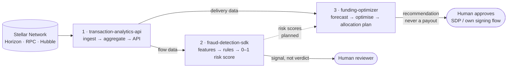

<div align="center">


# StellarSI

### Real-time analytics, fraud signals, and funding intelligence for the Stellar network

[](https://github.com/StellarSI)
[](https://stellar.org)
[](https://github.com/StellarSI/.github)
[](https://github.com/orgs/StellarSI/repositories)

**[Data layer](#1--transaction-analytics-api--data-layer)** ·
**[Risk layer](#2--fraud-detection-sdk--risk-layer)** ·
**[Decision layer](#3--funding-optimizer--decision-layer)** ·
[Architecture](#architecture--how-the-pieces-fit) ·
[Contribute](#contribute) ·
[Security](#security--responsible-use)

</div>

---

## Why StellarSI exists

Stellar moves value across borders in seconds, at low cost, in native
multi-asset payments — but a block explorer alone cannot answer the
questions that wallets, anchors, NGOs, funders, and compliance teams
actually ask:

- *Who is moving what, where, and how fast?*
- *Which accounts and transactions look anomalous — and why?*
- *How should a grant budget be split, delivered, and measured?*

StellarSI turns raw ledger activity into **queryable insight, explainable
risk signals, and defensible allocation decisions** — three open-source
tools that share one data foundation, one design philosophy, and one
rule: **software recommends; humans decide. Nothing here signs, submits,
or moves funds.**

## At a glance

| # | Repository | Layer | One-liner | Stack | Status |
|---|---|---|---|---|---|
| 1 | [`transaction-analytics-api`](https://github.com/StellarSI/transaction-analytics-api) | **Data** | Real-time Stellar transaction-flow analytics API | TypeScript · Node 20+ · Fastify · TimescaleDB · Redis/BullMQ | In development |
| 2 | [`fraud-detection-sdk`](https://github.com/StellarSI/fraud-detection-sdk) | **Risk** | Explainable anomaly detection & risk scoring for Stellar accounts | TypeScript · Node 20+ · Vitest | Alpha |
| 3 | [`funding-optimizer`](https://github.com/StellarSI/funding-optimizer) | **Decision** | Predictive analytics & constrained optimisation for grants and NGO disbursement | Python 3.11+ · NumPy · SciPy/HiGHS | In development |
| — | [`.github`](https://github.com/StellarSI/.github) | Meta | This organisation profile + (future) shared templates | Markdown | — |

All three product repositories are **MIT-licensed**, CI-tested
([GitHub Actions](https://github.com/StellarSI/transaction-analytics-api/actions)
in every repo), and ship with `CONTRIBUTING.md` and `SECURITY.md`.



---

## Architecture — how the pieces fit

```
                          ┌─────────────────────────────────────────────┐
 Stellar Network          │  1 · TRANSACTION-ANALYTICS-API  (data layer) │
 ───────────────          │  Horizon SSE + Stellar RPC + Hubble backfill │
 Horizon (classic ops) ──▶│  → Ingestors → Redis/BullMQ queue          │
 Stellar RPC  (Soroban) ─▶│  → Aggregators → TimescaleDB hypertables    │
 Hubble (BigQuery history)─▶│  → REST + SSE API  (planned surface: /v1)  │
                          └──────────────┬───────────────┬──────────────┘
                                         │               │
                       flow aggregates   │               │ delivery aggregates
                                         ▼               ▼
                          ┌────────────────────┐  ┌──────────────────────┐
                          │ 2 · FRAUD-DETECTION│  │ 3 · FUNDING-OPTIMIZER│
                          │    SDK (risk layer)│  │   (decision layer)   │
                          │ Horizon *or* the   │  │ Program data +       │
                          │ analytics API as   │  │ on-chain delivery    │
                          │ DataSource →       │  │ data → forecast +    │
                          │ features → rules / │  │ constrained LP       │
                          │ stats / ML →       │  │ solver → plan        │
                          │ score 0–1 + signals│  │ (deterministic)      │
                          └─────────┬──────────┘  └──────────┬───────────┘
                                    │  signals, not verdicts  │ recommendation
                                    ▼                         ▼
                              Human reviewer          Human approves payout
```

* `*` The fraud SDK can read Horizon directly or consume
  `transaction-analytics-api` through its `DataSource` adapter
  (`src/clients/transactionAnalytics.ts`), so the analytics API is the
  intended shared foundation — not a hard dependency.
* Funders / NGOs use the optimizer's plan as an input to the
  [Stellar Disbursement Platform (SDP)](https://developers.stellar.org/platforms/stellar-disbursement-platform)
  or their own signing flow. Risk-score integration
  (`funding-optimizer` ← `fraud-detection-sdk`) is on both roadmaps.

---

## 1 · `transaction-analytics-api` — data layer

> APIs for real-time transaction flow insights on the Stellar network.

[](https://github.com/StellarSI/transaction-analytics-api/stargazers)
[](https://github.com/StellarSI/transaction-analytics-api/network/members)
[](https://github.com/StellarSI/transaction-analytics-api/issues)
[](https://github.com/StellarSI/transaction-analytics-api/actions/workflows/ci.yml)
[](https://github.com/StellarSI/transaction-analytics-api)
[](https://github.com/StellarSI/transaction-analytics-api/blob/main/LICENSE)

Turns raw ledger activity into queryable, real-time insight: **who is
moving what, where value is flowing, and how fast** — for wallets,
anchors, NGOs, compliance teams, and researchers who need more than a
block explorer.

**Implemented today** (in `main`, unit-tested with Vitest):

- **Ingestion** — SSE streaming from Horizon with paging-token cursors
  and exponential-backoff reconnects: payments, path payments
  (strict-send *and* strict-receive, with corridor metadata), claimable
  balances (SEP-11), and offers / DEX operations (full create→delete
  life cycle). Soroban contract events via Stellar RPC.
- **Historical backfill** — idempotent, resumable pulls from SDF's
  public Hubble BigQuery dataset (`crypto_stellar`), filtered by asset /
  account, enqueuing aggregation jobs per bucket.
- **Aggregation** — per-asset flows (volume, payments, issuer-attributed
  net flow, in bigint stroops — never floats), per-account insights
  (inflow/outflow, counterparties), corridor aggregates, trustlines,
  and minute/hour/day time buckets. Fork-safe: reorgs trigger
  re-aggregation from the raw `ledger_operations` source of truth.
- **Infrastructure** — BullMQ over Redis Streams (Zod-validated
  payloads, retries, Prometheus `eta_queue_*` / `eta_asset_flow_*`
  metrics), Drizzle ORM over TimescaleDB hypertables with compression,
  Argon2 API-key hashing, Fastify security headers/rate-limiting.

**Planned API surface** (`/v1`, see the repo README for the full table):
asset & account flows, corridors, SSE transaction stream, webhooks,
`/v1/health`. Start on **testnet** ([Friendbot](https://developers.stellar.org/docs/learn/fundamentals/networks#friendbot)).

### Repository structure

```
transaction-analytics-api/
├── migrations/                  # Versioned SQL — TimescaleDB hypertables
│   ├── 0001_enable_timescaledb.sql
│   ├── 0002_ledger_operations.sql
│   ├── 0003_aggregates.sql
│   ├── 0004_trustline_aggregates.sql
│   └── 0005_time_buckets_continuous_aggregates.sql
├── src/
│   ├── index.ts                 # Service entry point
│   ├── config/  db/             # Env config · pool, migrate, schema/
│   ├── ingestor/
│   │   ├── horizon/             # payments · path-payments · claimable-balances
│   │   │                        # offers · client (cursor/backoff) · stream
│   │   ├── hubble/              # backfill.ts (BigQuery) · store.ts
│   │   └── rpc/                 # soroban.ts (contract events)
│   ├── aggregator/              # asset-flows · account-insights · corridors
│   │                            # trustlines · time-buckets
│   ├── queue/  redis/           # BullMQ registry/processors/metrics · client/health
│   └── logger.ts  ingestor/types.ts
├── tests/integration/           # Migration integration tests
├── .github/workflows/ci.yml     # Lint · typecheck · unit/integration/e2e (Vitest)
└── package.json                 # Node ≥20 · @stellar/stellar-sdk · Fastify · Zod
```

### Quick start

```bash
git clone https://github.com/StellarSI/transaction-analytics-api.git
cd transaction-analytics-api
npm install && cp .env.example .env   # STELLAR_NETWORK, HORIZON_URL, DATABASE_URL, REDIS_URL…
npm run dev                            # applies migrations, starts ingestion
```

📖 [Full README](https://github.com/StellarSI/transaction-analytics-api/blob/main/README.md) ·
[Contributing](https://github.com/StellarSI/transaction-analytics-api/blob/main/CONTRIBUTING.md) ·
[Security](https://github.com/StellarSI/transaction-analytics-api/blob/main/SECURITY.md) ·
[Open issues](https://github.com/StellarSI/transaction-analytics-api/issues)

---

## 2 · `fraud-detection-sdk` — risk layer

> AI models for anomaly detection in Stellar transactions — explainable,
> auditable risk signals for Stellar accounts.

[](https://github.com/StellarSI/fraud-detection-sdk/stargazers)
[](https://github.com/StellarSI/fraud-detection-sdk/network/members)
[](https://github.com/StellarSI/fraud-detection-sdk/issues)
[](https://github.com/StellarSI/fraud-detection-sdk/actions/workflows/ci.yml)
[](https://github.com/StellarSI/fraud-detection-sdk)
[](https://github.com/StellarSI/fraud-detection-sdk/blob/main/LICENSE)

Generic fraud models miss patterns unique to Stellar. This SDK scores
Stellar accounts and transactions on a **0–1 scale with named,
weighted signals and human-readable explanations**, targeting
Stellar-specific abuse: path-payment layering, trustline abuse / asset
spam / dusting, fresh-account and rapid-merge tricks, claimable-balance
spam, memo reuse, and rapid fan-in / fan-out.

```
Horizon ──or── transaction-analytics-api
                 │
                 ▼        Feature extraction (velocity · graph · asset
        ┌─ Rules ──·── Statistical ──·── ML (planned) ─┐   memo · lifecycle)
        └──────────────────────────────────────────────┘
                 ▼
        Score (0–1) + signals + explanation  →  low / medium / high
```

**Risk bands** (configurable): `low < 0.40` proceed ·
`medium 0.40–0.70` log & monitor · `high > 0.70` hold for manual review.

> ⚠️ **Alpha.** The public API may change between releases. A score is a
> *signal, not a verdict* — expect false positives for new accounts and
> legitimate high-volume actors (anchors, market makers), and keep a
> human in the loop. Package names are placeholders until the first
> published release; `watch()` streaming is planned, not yet implemented.

### Repository structure

```
fraud-detection-sdk/
├── src/
│   ├── FraudDetector.ts         # Entry point: scoreAccount() orchestration
│   ├── index.ts  types.ts  config.ts  errors.ts  logging.ts  network.ts
│   ├── clients/                 # horizon (retry+pagination) · http (backoff)
│   │                            # transactionAnalytics (DataSource) · errorMapping
│   ├── features/                # velocity · graph · assets · memo · lifecycle
│   │                            # pathPaymentLayering · trustlineAbuse · registry
│   ├── rules/                   # engine · path-payment & trustline rules
│   └── scoring/                 # aggregate · levels (bands) · normalize
├── docs/architecture.md
├── .github/                     # Bug/feature templates · PR template · ci.yml
├── ROADMAP.md                   # Alpha → 0.1.x core detection → 0.2.x reliability → 1.0
└── package.json                 # Node ≥20 · TypeScript 5 · Vitest (zero runtime deps)
```

### Quick start

```ts
import { FraudDetector } from "@stellarsi/fraud-detection-sdk";

const detector = new FraudDetector({
  network: "testnet",
  horizonUrl: "https://horizon-testnet.stellar.org",
});

const result = await detector.scoreAccount("G…”);
console.log(result.score);   // 0.87
console.log(result.level);   // "high"
console.log(result.signals); // [{ id: "rapid-fan-out", weight: 0.41 }, …]
```

📖 [Full README](https://github.com/StellarSI/fraud-detection-sdk/blob/main/README.md) ·
[Architecture](https://github.com/StellarSI/fraud-detection-sdk/blob/main/docs/architecture.md) ·
[Roadmap](https://github.com/StellarSI/fraud-detection-sdk/blob/main/ROADMAP.md) ·
[Contributing](https://github.com/StellarSI/fraud-detection-sdk/blob/main/CONTRIBUTING.md) ·
[Open issues](https://github.com/StellarSI/fraud-detection-sdk/issues)

---

## 3 · `funding-optimizer` — decision layer

> Predictive analytics for grant allocation and NGO disbursement on Stellar.

[](https://github.com/StellarSI/funding-optimizer/stargazers)
[](https://github.com/StellarSI/funding-optimizer/network/members)
[](https://github.com/StellarSI/funding-optimizer/issues)
[](https://github.com/StellarSI/funding-optimizer/actions/workflows/ci.yml)
[](https://github.com/StellarSI/funding-optimizer)
[](https://github.com/StellarSI/funding-optimizer/blob/main/LICENSE)

Helps funders and NGOs decide **how much to send, to whom, and when** —
then measures how well funds actually reached people. It pairs
deterministic optimisation with on-chain Stellar delivery data (via
Horizon or `transaction-analytics-api`), complementing the
[Stellar Disbursement Platform](https://developers.stellar.org/platforms/stellar-disbursement-platform)
and grant programmes such as the
[Stellar Community Fund](https://communityfund.stellar.org).

**Implemented today** (`funding_optimizer/optimizer/`, fully tested):

- `solver.py` — deterministic LP adapter over SciPy/HiGHS with pinned
  options and lexicographic tie-breaking (identical inputs ⇒ identical
  allocations).
- `constraints.py` + `models.py` — regional-floor fairness, per-program
  minimums/caps, and validated single- or multi-asset `Budget`s
  (e.g. `{"USDC": 150_000, "XLM": 40_000_000}`).
- `diagnostics.py` — actionable infeasibility explanations ("floors
  exceed budget") instead of bare failures.
- `schedule.py` — phased allocation for tranched budgets, carrying
  unabsorbed budget forward across phases.
- `sensitivity.py` — `base ± δ` re-solves reporting binding constraints
  and objective deltas.
- `forecasting/schema.py` — the typed forecast contract (observation
  windows, horizons, cash-out / delay / funding-gap targets, evaluation
  metrics) that every future forecast model consumes and produces.

**Planned:** delivery-time & cash-out forecasting models, scenario
comparison, SDP-compatible export, funder dashboard, and
`fraud-detection-sdk` risk-score integration (all tracked on the
[roadmap](https://github.com/StellarSI/funding-optimizer/blob/main/README.md#roadmap)).

### Repository structure

```
funding-optimizer/
├── funding_optimizer/
│   ├── optimizer/               # solver · constraints · diagnostics
│   │                            # schedule · sensitivity · cohorts · commitments
│   ├── forecasting/             # schema.py — dataset/window/horizon/target types
│   └── models.py  __init__.py
├── tests/                       # pytest — solver, constraints, multi-asset,
│                                # diagnostics, schedule, sensitivity, forecasting…
├── docs/architecture.md
├── .github/                     # Templates · release checklist · ci.yml
├── Makefile  .pre-commit-config.yaml  pyproject.toml
└── .env.example                 # STELLAR_NETWORK · HORIZON_URL · ANALYTICS_API_URL
```

### Quick start

```bash
git clone https://github.com/StellarSI/funding-optimizer.git
cd funding-optimizer
python -m venv .venv && source .venv/bin/activate
pip install -e ".[dev]" && cp .env.example .env
make check                       # lint + typecheck + tests
```

```python
from funding_optimizer.optimizer.constraints import Program, RegionFloor, solve_allocation

programs = [
    Program(id="cash-transfers-ng", region="Africa", expected_reach=12_000, min_share=0.20),
    Program(id="education-ke",     region="Africa", expected_reach=4_500,  min_share=0.10),
    Program(id="health-gh",       region="Africa", expected_reach=7_800,  min_share=0.15),
]
result = solve_allocation(programs, budget=250_000,
                          region_floors=[RegionFloor(region="Africa", floor=0.50)])
print(result.allocation, result.objective_value)
```

📖 [Full README](https://github.com/StellarSI/funding-optimizer/blob/main/README.md) ·
[Architecture](https://github.com/StellarSI/funding-optimizer/blob/main/docs/architecture.md) ·
[Contributing](https://github.com/StellarSI/funding-optimizer/blob/main/CONTRIBUTING.md) ·
[Open issues](https://github.com/StellarSI/funding-optimizer/issues)

---

## Technology at a glance

| Concern | `transaction-analytics-api` | `fraud-detection-sdk` | `funding-optimizer` |
|---|---|---|---|
| Language / runtime | TypeScript · Node 20+ | TypeScript · Node 20+ | Python 3.11+ |
| Data & infra | PostgreSQL 15+ / TimescaleDB · Redis · BullMQ · Drizzle ORM | Horizon REST · analytics-API adapter (no DB) | NumPy · SciPy/HiGHS LP solver |
| Service / API | Fastify · Zod · SSE · Prometheus · Pino | Library (`FraudDetector.scoreAccount`) | Library + solver modules |
| Tests | Vitest (unit / integration / e2e) | Vitest (co-located `*.test.ts`) | pytest (`tests/`) |
| Quality gates | ESLint + Prettier · `tsc --noEmit` | ESLint · `npm run check` | Ruff + Black · mypy · `make check` |
| CI | GitHub Actions `ci.yml` | GitHub Actions `ci.yml` | GitHub Actions `ci.yml` |
| License | MIT | MIT | MIT |

---

## Shared principles

1. **Recommend, never transact.** No StellarSI tool signs transactions,
   submits payouts, or moves funds. Payouts stay under your control
   (SDP or your own signing flow).
2. **Signals, not verdicts.** Risk scores and allocations are decision
   *support*. Keep a human in the loop, especially where decisions
   affect people's access to essential services.
3. **Explainable & auditable.** Every score names its signals; every
   allocation is deterministic and reproducible; delivery is traceable
   to on-chain transaction hashes.
4. **Testnet first.** Develop and evaluate against Stellar testnet
   (Friendbot-funded) before touching mainnet data.
5. **Privacy by design.** Prefer pseudonymous Stellar addresses over
   personal identifiers; collect and store only the recipient data you
   need; redact secrets in logs and config representations.
6. **Open by default.** MIT-licensed, issue-driven development with
   `good first issue` labels in every product repository.

---

## Contribute

New contributors are welcome in all three repositories — no invite needed.

1. **Pick a starting point:**
   [`good first issue`](https://github.com/StellarSI/fraud-detection-sdk/issues?q=label%3A%22good+first+issue%22+is%3Aissue+is%3Aopen)
   in each repo ([analytics](https://github.com/StellarSI/transaction-analytics-api/issues?q=label%3A%22good+first+issue%22+is%3Aissue+is%3Aopen) ·
   [fraud](https://github.com/StellarSI/fraud-detection-sdk/issues?q=label%3A%22good+first+issue%22+is%3Aissue+is%3Aopen) ·
   [funding](https://github.com/StellarSI/funding-optimizer/issues?q=label%3A%22good+first+issue%22+is%3Aissue+is%3Aopen)).
   Difficulty labels (`intermediate`, `advanced`) and area labels
   (`product-ingestion`, `product-aggregation`, `product-api`,
   `security`, `testing`, `docs-tooling`, …) help you scope a PR.
2. **Read the repo guide first:** `CONTRIBUTING.md` in the repo you're
   touching (setup, branching, PR standards, review expectations).
3. **Open an issue first** for larger changes; use the bug / feature
   templates. Run the repo's checks before submitting:

   ```bash
   # transaction-analytics-api
   npm run lint && npm run typecheck && npm test
   # fraud-detection-sdk
   npm run check            # typecheck + lint + test
   # funding-optimizer
   make check               # lint + typecheck + tests
   ```

4. **Security issues:** report privately via GitHub Security Advisories —
   never in a public issue (see each repo's `SECURITY.md`).

### Contributors

Thanks to everyone building StellarSI in the open — notably
[`@devrabiuhussain`](https://github.com/devrabiuhussain) (core
contributor across all three repositories) and
[`@OthmanImam`](https://github.com/OthmanImam). See each repo's
[contributors graph](https://github.com/StellarSI/transaction-analytics-api/graphs/contributors)
for the full, live list.

---

## Security & responsible use

- **Vulnerabilities:** use
  [GitHub Security Advisories](https://github.com/StellarSI/transaction-analytics-api/security/advisories)
  in the affected repository. See `SECURITY.md` in each repo.
- **Fraud scores** can mislabel new or high-volume legitimate accounts —
  never use them as the sole basis for blocking access to essential
  services; monitor for drift and bias.
- **Allocation models** affect real people — audit across regions and
  recipient groups before acting on them.

## Roadmap (cross-cutting)

| Horizon | theme |
|---|---|
| Now | Ingestors & aggregators, deterministic solver, core scoring pipeline |
| Next | REST/SSE + webhooks · statistical baselines · forecast models · scenario reports |
| Later | Soroban analytics · trained ML models · SDP export · funder dashboards · hosted instances · stable 1.0 releases |

Each repository carries its own roadmap (see `ROADMAP.md` /
README checklists) — issues are the source of truth.

## Community & ecosystem

- [Stellar Developers](https://developers.stellar.org) ·
  [Stellar Expert](https://stellar.expert) ·
  [Horizon docs](https://developers.stellar.org/docs/data/apis/horizon) ·
  [Stellar Disbursement Platform](https://developers.stellar.org/platforms/stellar-disbursement-platform) ·
  [Stellar Community Fund](https://communityfund.stellar.org)
- Questions and ideas: open an issue or discussion in the relevant
  repository. Bug and feature templates are provided in
  `fraud-detection-sdk` and `funding-optimizer`.

---

<div align="center">

**StellarSI** — analytics, risk, and funding intelligence for Stellar.

MIT License · Built in the open on the Stellar network

⭐ Star the repo you use · 🍴 Fork what you need · 🐛 Report what you find

</div>
